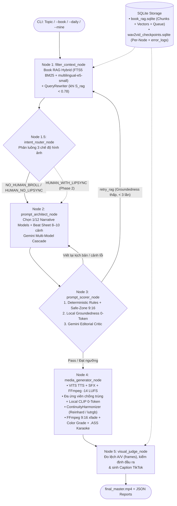

<div align="center">

# 🎬 wav2video — Agentic Short Documentary & Book-to-Video Pipeline (9:16)

**Biến một chủ đề tự do hoặc cả một cuốn sách (`.epub` / `.txt` / `.docx` / `.pdf`) thành video tài liệu ngắn dọc 9:16 hoàn chỉnh — tự động biên kịch theo 12 mô hình tự sự, kiểm định Groundedness 0-token, lồng tiếng Neural VITS tiếng Việt, tổng hợp SFX, tải Video Footage HD và dựng phụ đề Karaoke chuẩn TikTok / Reels / Shorts.**

[](https://www.python.org/)
[](https://langchain-ai.github.io/langgraph/)
[](https://ai.google.dev/)
[](https://huggingface.co/intfloat/multilingual-e5-small)
[](https://ffmpeg.org/)

</div>

---

## ✨ Điểm khác biệt cốt lõi

Thay vì sinh video kiểu *"slide ảnh vô hồn, hoạt hình trẻ con, hình một đằng – tiếng một nẻo"*, `wav2video` được thiết kế theo chuẩn **Đạo diễn Phim Tài liệu Ngắn**:

* **📚 Book RAG Hybrid Search & Hàng đợi Đăng Hằng Ngày**: Nạp cả cuốn sách vào SQLite một lần duy nhất (< 0.1s tách chương, nhúng vector local `intfloat/multilingual-e5-small` + chỉ mục FTS5 BM25). Tự động khai thác góc kể (`Angle Miner`) và xuất đều đặn mỗi ngày 1 video sâu từng chi tiết mà **không tốn token đọc lại cả sách**.
* **🧠 12 Mô hình Kịch bản & 4 Nguyên lý Nhận thức**: Tự chấm điểm chủ đề để chọn Beat Sheet tối ưu (`ABT`, `In Medias Res`, `Myth vs. Reality`, `Open Loops`, `Rule of Three`, `SCQA`, `PAS`, `AIDA`...), áp dụng *Information Gap* cho Hook 6–11 từ và *Habituation Break* xen cảnh Twist ngắn gắt.
* **🛡️ Groundedness 0-Token & QueryRewriter Loop**: Chấm mức độ bám sát sách ngay trên CPU bằng Vector Cosine (0 tốn token LLM Scorer); nếu kịch bản lệch nguồn hoặc topic quá trừu tượng (`S_rag < 0.78`), hệ thống tự mở rộng từ khóa qua `QueryRewriter` và tìm lại chunk khác.
* **🗣️ Tách đôi Giọng đọc (`narration_vn`) & Phụ đề Mắt đọc (`subtitle_vn`)**: TTS đọc thuần chữ tự nhiên (*"năm một nghìn chín trăm năm mươi tư"*), còn màn hình hiện gọn *"năm 1954"*, *"20%"* kèm highlight từng từ và Safe-Zone 1/3 dưới.
* **🎞️ Tự động săn Footage HD thật + Chấm CLIP 0-Token + Nhạc nền `-14 LUFS`**: Lấy đa ứng viên video stock (Mixkit / Pexels / Pixabay) chống trùng lặp giữa các cảnh, trích keyframe bằng `ffmpeg` và chấm khớp ngữ nghĩa + lọc dính người ngay trên CPU bằng `openai/clip-vit-base-patch32` (0-token API), cân bằng màu liên tục (`ContinuityHarmonizer` qua Reinhard / `lutrgb`), lồng tiếng Neural VITS tiếng Việt (`facebook/mms-tts-vie`), trộn SFX và chuẩn hóa âm lượng `-14 LUFS`.
* **🌊 Luồng Google Flow 4 Block Liền Mạch (`--flow-prep` / `--flow-render`)**: Tự động đo thời lượng audio thật để chia kịch bản thành 4 Block cân bằng (`flow_prompts.txt`) kèm neo nối cảnh (*seamless continuation*); khi bạn tải clip Flow về `flow_clips/`, hệ thống tự khớp đúng block theo tên file gốc và dựng hoàn chỉnh không tốn thêm token LLM.
* **🩺 Checkpoint từng Node & Error Logs SQLite**: Lưu trạng thái sau mỗi node vào `wav2vid_checkpoints.sqlite`, ghi log phiên chạy vào `workspace/logs/latest.log` và bảng `error_logs` để truy vết lỗi tức thì qua `--logs`.

---

## 🏗️ Kiến trúc Luồng Xử lý (LangGraph StateGraph)



---

## 🎯 Chi tiết Tính năng Hệ thống

### 1. Kho 12 Mô hình Kịch bản ([`prompts/narrative_models.py`](prompts/narrative_models.py))
| Nhóm mục tiêu | ID Mô hình | Cấu trúc cốt lõi |
|---|---|---|
| **Phim Tài liệu / Kể chuyện** | `abt` | Bối cảnh (*And*) → Mâu thuẫn (*But*) → Hệ quả (*Therefore*) |
| | `in_medias_res` | Nhảy thẳng vào khoảnh khắc căng nhất → Tua ngược → Kết cục |
| | `freytag_3_act` | Thiết lập → Leo thang → Cao trào → Hạ nhiệt → Kết cục |
| | `pixar_story_spine` | *Ngày xửa... Mỗi ngày... Cho đến một ngày... Vì thế...* |
| | `scqa` | Situation → Complication → Question → Answer (McKinsey) |
| **Short-Form Viral (9:16)** | `hook_retain_payoff` | Hook 3s sốc → Leo thang dữ kiện mới → Payoff bùng nổ |
| | `myth_vs_reality` | Lầm tưởng phổ biến → Phá định kiến → Sự thật ẩn → Bằng chứng |
| | `open_loops` | Mở vòng lặp A → Mở vòng lặp B → Giải mã B → Đóng trọn A |
| | `rule_of_three` | Hook tổng → Điểm 1 → Điểm 2 → Twist → Điểm 3 đắt giá nhất |
| **Thuyết phục / B2B** | `pas` | Problem (Vấn đề) → Agitate (Khoét nỗi đau) → Solution |
| | `bab` | Before (Trước) → After (Sau) → Bridge (Cầu nối giải pháp) |
| | `aida` | Attention → Interest → Desire → Action |

### 2. Bộ định tuyến Ý định 3 Chế độ ([`graph/nodes/intent_router.py`](graph/nodes/intent_router.py))
| Chế độ (`--mode`) | Mục đích & Quy tắc hình ảnh | Trạng thái hiện tại |
|---|---|---|
| `NO_HUMAN_BROLL` *(Mặc định)* | Không có người trong khung hình; tập trung tư liệu, địa điểm, vật thể, kiến trúc. | ✅ **Hoàn thiện** |
| `HUMAN_NO_LIPSYNC` | `≥ 60%` cảnh có người hành động tự nhiên (góc nghiêng/sau lưng/đôi tay), không nhìn thẳng nhép môi. | ✅ **Hoàn thiện MVP** |
| `HUMAN_WITH_LIPSYNC` | Nhân vật/Avatar nói trực diện khớp khẩu hình miệng. | 🚧 *Phase 2 (tự hạ an toàn về `HUMAN_NO_LIPSYNC`)* |

---

## 📁 Cấu trúc Dự án

```text
wav2video/
├── main.py                         # CLI Entrypoint (--ingest, --mine, --book, --daily, --model, --logs)
├── config/
│   └── settings.py                 # Nạp cấu hình từ .env (API keys, FPS, kích thước 9:16, ngưỡng điểm)
├── prompts/
│   ├── narrative_models.py         # 12 mô hình kịch bản + 4 nguyên lý nhận thức + bộ chấm điểm tự chọn
│   ├── architect_prompt.py         # Prompt Đạo diễn/Biên kịch 8–10 cảnh + Safe-Zone 9:16
│   ├── scorer_prompt.py            # Prompt Giám khảo Biên tập (Hook 30%, Visual 35%, Story 35%)
│   ├── angle_miner_prompt.py       # Prompt khai thác 3–6 góc kể độc lập từ 1 chunk sách
│   └── outro_moral_prompt.py       # Prompt chuốt Voiceover TTS & Subtitle đồng bộ 8–10 cảnh
├── graph/
│   ├── workflow.py                 # StateGraph, Per-Node SqliteSaver Checkpointer & Error Log DB
│   ├── state.py                    # TypedDict State, Reducers (`error_logs`, `characters`) & Pydantic Schemas
│   ├── llm_client.py               # Gemini Multi-Model Cascade (gemini-3.1-flash-lite -> 3-flash) + Free LLM fallback
│   ├── book_rag.py                 # Parser (.epub/.txt/.md/.docx/.pdf), FTS5 + multilingual-e5 Hybrid Search, 0-Token Groundedness
│   ├── asset_fetcher.py            # Đa ứng viên Video HD (Mixkit / Pexels / Pixabay), chống trùng & Ảnh AI Pollinations
│   ├── visual_scorer.py            # VisualFeatureScorer 0-token (ffmpeg keyframe, local CLIP, dark/static) & ContinuityHarmonizer
│   ├── flow_bundler.py             # Chia 4 Block cân bằng cho Google Flow (--flow-prep) & dựng phim từ clip Flow (--flow-render)
│   ├── audio_sync.py               # Local VITS TTS (facebook/mms-tts-vie), DSP Broadcast, Auto-Ducking BGM, SFX & -14 LUFS
│   ├── video_renderer.py           # FFmpeg 9:16 Composer (Zoom/Pan, lutrgb, Xfade, Genre Grade, .ASS Karaoke, Auto-Cleanup)
│   ├── run_logger.py               # Auto Tee File Logger (`workspace/logs/latest.log`) & CLI Diagnostics
│   └── nodes/
│       ├── filter_context.py       # Node 1: Book RAG Retrieval + QueryRewriter
│       ├── intent_router.py        # Node 1.5: 3-Mode Intent Router
│       ├── prompt_architect.py     # Node 2: Đạo diễn & Sinh kịch bản JSON
│       ├── prompt_scorer.py        # Node 3: Deterministic Rules + Local Groundedness + LLM Critic
│       ├── media_generator.py      # Node 4: Điều phối TTS, Visual Assets, Harmonizer & FFmpeg Render
│       └── visual_judge.py         # Node 5: Kiểm định đồng bộ A/V & xuất báo cáo duyệt thủ công
├── tests/
│   └── test_visual_phase2.py       # Bộ unit & E2E tests cho Tầng 2 (CLIP, Harmonizer, -14 LUFS, Flow pipeline)
└── workspace/
    ├── book_rag.sqlite             # Kho chunk sách + vector embeddings + hàng đợi đăng hằng ngày
    ├── wav2vid_checkpoints.sqlite  # Checkpoints từng node & bảng `error_logs`
    └── logs/                       # File log chi tiết từng lần chạy (latest.log)
```

---

## ⚙️ Cài đặt

### 1. Môi trường Python & Thư viện
```bash
git clone https://github.com/dungna13/wav2video.git
cd wav2video

python3 -m venv .venv
source .venv/bin/activate        # Trên Windows: .venv\Scripts\activate
pip install -r requirements.txt
```

### 2. Cấu hình `.env`
```bash
cp .env.example .env
```
Mở `.env` và điền khóa API của bạn (tuyệt đối không commit file `.env`):
```env
GEMINI_API_KEY="YOUR_GEMINI_API_KEY_HERE"
GEMINI_MODEL="gemini-3.1-flash-lite-preview"

# (Tùy chọn) Video stock chất lượng cao qua API ngoài Mixkit miễn phí sẵn có
PEXELS_API_KEY=""
PIXABAY_API_KEY=""
```
> *Ghi chú: Hệ thống tự dùng **Mixkit HD Scraper** (không cần API key), **Local VITS Vietnamese TTS** và **Local `intfloat/multilingual-e5-small`** chạy offline/CPU sau lần tải đầu tiên.*

---

## 🚀 Hướng dẫn Sử dụng trên Terminal

### 1. Chạy từ Chủ đề tự do
```bash
# Tự động chọn mô hình kịch bản & chế độ hình ảnh phù hợp
python main.py "Bí ẩn sự sụp đổ đột ngột của nền văn minh Maya"

# Chỉ định chế độ có người minh họa (không nhép môi) & mô hình kịch bản
python main.py --mode HUMAN_NO_LIPSYNC --model myth_vs_reality "Tại sao người bán hàng pha lê sợ ước mơ thành sự thật"
```

### 2. Quy trình Làm Video Hằng Ngày từ Sách (`.epub`, `.txt`, `.md`, `.docx`, `.pdf`)
```bash
# Bước 1: Nạp sách 1 lần duy nhất (tự tách chương, tạo vector local & hàng đợi topic)
python main.py --ingest NhaGiaKim.epub

# Bước 2: Xem toàn bộ hàng đợi chunk & trạng thái (WAIT / DONE)
python main.py --list-book nha_gia_kim

# Bước 3 (Tùy chọn): Khai thác 4 góc kể sắc nét từ 1 chương sách bất kỳ
python main.py --mine nha_gia_kim --chunk 21

# Bước 4A: Chế độ ĐĂNG HẰNG NGÀY — tự bốc chunk WAIT kế tiếp, render video & đánh dấu DONE
python main.py --book nha_gia_kim --daily

# Bước 4B: Hoặc gõ topic tự do, RAG Hybrid Search tự tìm đúng đoạn sách tương ứng
python main.py --book nha_gia_kim "Bí mật hạnh phúc qua câu chuyện hai giọt dầu"

# Bước 4C: Hoặc ép chạy đúng một chunk cụ thể
python main.py --book nha_gia_kim --chunk 14 --model abt
```

### 3. Luồng Bán Tự Động với Google Flow (4 Block Liền Mạch)
```bash
# Bước 1: Lên kịch bản + sinh audio -14 LUFS + xuất 4 Block prompt nối tiếp (`flow_prompts.txt`)
python main.py --flow-prep "Chủ đề của bạn"

# Hoặc dùng với sách RAG (mặc định --blocks 4, có thể đổi --blocks 3 hoặc 5)
python main.py --flow-prep --book nha_gia_kim --chunk 14 --mode HUMAN_NO_LIPSYNC

# Bước 2: Copy 4 prompt trong `flow_prompts.txt` sang Google Flow (dùng Extend / Start Frame từ Block 2)
#         rồi tải 4 file .mp4 thả vào thư mục `flow_clips/` (giữ nguyên tên gốc của Flow cũng được).

# Bước 3: Dựng video hoàn chỉnh (tự khớp clip vào đúng block, cân bằng màu, phụ đề karaoke)
python main.py --flow-render "workspace/flow_<ten_thu_muc_vua_tao>"
```

### 4. Kiểm tra Log, Checkpoint & Chạy Test
```bash
# Xem 5 checkpoint gần nhất, bảng error_logs trong SQLite và 25 dòng cuối của latest.log
python main.py --logs

# Chạy toàn bộ bộ kiểm thử Tầng 2 (VisualScorer, ContinuityHarmonizer, -14 LUFS, Flow)
python -m unittest discover -s tests -v
```

---

## 📦 Đầu ra mỗi lần chạy (`workspace/run_<topic>_<timestamp>/`)

Sau khi dựng xong `final_master.mp4`, hệ thống **tự động dọn sạch toàn bộ file trung gian** (`clip_*.mp4`, `scene_*`, `raw_visual_merged.mp4`), chỉ giữ lại đúng các thành phẩm gọn nhẹ (~10–14 MB/video):

| File đầu ra | Mô tả |
|---|---|
| `final_master.mp4` | Video dọc 9:16 (30fps, H.264/AAC), đã ghép giọng đọc, nhạc nền ducking, SFX chuyển nhịp, chỉnh màu theo thể loại và phụ đề Karaoke |
| `audio_16k_mono.wav` | Bản thu giọng đọc VITS Studio + Ambient BGM + SFX cues |
| `subtitles.ass` | File phụ đề động 3 từ/nhịp + chữ in hoa từ khóa neo |
| `scene_timeline.json` | Dữ liệu mốc thời gian từng cảnh (`voice_start`, `voice_end`, `sfx_cue`, `media_source`) |
| `visual_score_report.json` & `output_score_report.json` | Báo cáo điểm thực tế và độ lệch khung hình A/V |

---

## 🗺️ Lộ trình Phát triển (So với [`wav2vid.md`](wav2vid.md))

* [x] **Tầng 1 (100%)**: Intent Router 3 chế độ, 12 Mô hình Kịch bản + Beat Sheets, Book RAG Hybrid Search (`FTS5` + `multilingual-e5-small`), Angle Miner, Local Groundedness 0-Token & `QueryRewriter` Loop (`retry_rag < 3`).
* [x] **Độ tin cậy & Quan sát (100%)**: Checkpoint SQLite sau từng Node, bảng `error_logs`, Auto File Logging (`--logs`) & Gemini Multi-Model Cascade.
* [ ] **Tầng 2 Nâng cao (Đang phát triển)**: Chấm khung hình *video tải về thật* bằng Local CLIP (`openai/clip-vit-base-patch32` 0-token), lọc trùng clip Mixkit & cân màu đồng nhất giữa các cảnh (`ContinuityHarmonizer`).
* [ ] **Tầng 4 (HITL CLI)**: Giao diện duyệt nhanh trên terminal cho phép đổi riêng clip cảnh lỗi mà không cần chạy lại LLM/TTS.
* [ ] **Giai đoạn 2 (`HUMAN_WITH_LIPSYNC` & Tầng 5)**: Tích hợp `Wav2Lip` + `GFPGAN` + `SyncNet` (GPU CUDA) và TikTok Content Posting API v2.
