<div align="center">

# 🎬 wav2video
### The Code-Driven Documentary Film Studio (9:16)
**Xưởng Phim Tài Liệu & Video B-Roll Điện Ảnh Thuần Code Cho Nhà Sáng Tạo Nội Dung**

<p><b>Biến một chủ đề tự do, file kịch bản khai báo (.json), hoặc cả cuốn sách thành phim tài liệu ngắn 9:16 chuẩn điện ảnh.<br/>
Tự động biên kịch đa phân đoạn · Tuyển chọn B-Roll 4K sạch · Nhân bản giọng nói Offline F5-TTS · Hòa âm Studio -14 LUFS.</b></p>

---

[](https://www.python.org/)
[](https://ffmpeg.org/)
[](https://github.com/SWivid/F5-TTS)
[](https://ffmpeg.org/)
[](https://huggingface.co/intfloat/multilingual-e5-small)
[](LICENSE)

<sub>
<a href="#-phòng-trưng-bày-phim-mẫu-film-gallery"><b>Film Gallery</b></a> ·
<a href="#-4-phong-cách-sản-xuất-chính-production-styles"><b>Film Styles</b></a> ·
<a href="#-tiêu-chuẩn-đạo-diễn-directing-philosophy"><b>Directing Standards</b></a> ·
<a href="#-khởi-chiếu-nhanh-quick-start"><b>Quick Start</b></a> ·
<a href="#-hồ-sơ-kịch-bản-declarative-script"><b>Script Config</b></a> ·
<a href="#-star-history"><b>Star History</b></a>
</sub>

</div>

---

## 🏛️ Triết Lý: "Làm Phim Bằng Code, Không Phải Tech Demo"

Hầu hết các công cụ AI tạo video hiện nay tạo ra những sản phẩm *"slide ảnh vô hồn, giọng đọc Google Translate đơ cứng, hình ảnh ngẫu nhiên không ăn khớp lời thoại"*. 

**`wav2video`** được xây dựng dựa trên tư duy của một **Đạo diễn Phim Tài liệu Thực thụ (Film Director & Sound Stage)**:
* 🎬 **Nhịp dựng 3s–5s (Pacing & Rhythm)**: Không bao giờ để một cảnh đứng yên quá 5 giây. Tư liệu B-roll 4K được cắt ghép đan xen liên tục, dẫn dắt nhịp thở của người xem.
* 🛡️ **Kiểm duyệt khung hình sạch 100% (`_is_cut_usable`)**: Tự động phát hiện và loại bỏ triệt để các cảnh bị tối đen, cảnh mờ hoặc dính phụ đề gốc từ nguồn video YouTube.
* 🎚️ **Âm thanh là linh hồn (Sound Stage `-14 LUFS`)**: Giọng đọc được hòa âm đa tầng (Studio EQ, Ducking tự động hạ BGM xuống 68% khi đọc và ngân lên 95% khi ngắt nhịp, Cross-fade 1.5s lặp bài mượt mà không click/pop).
* 📄 **Kiểm soát xác định (Deterministic Scripting)**: Có thể tự động 100% bằng AI hoặc toàn quyền kiểm soát từng câu chữ và từ khóa tư liệu qua file cấu hình `script.json` — **không cần phụ thuộc vào Web UI cồng kềnh**.

---

## 🎥 Phòng Trưng Bày Phim Mẫu (Film Gallery)

Hai tác phẩm phim tài liệu hoàn chỉnh được xuất xưởng tự động 100% từ pipeline `wav2video`:

<table>
<tr>
<td align="center" width="50%" valign="top">

### 🐭 Tác Phẩm 1: Thí Nghiệm Universe 25
**"Thiên Đường Chuột & Sự Sụp Đổ"**  
<sub>Thể loại: *Phim Tài Liệu Điều Tra / Tâm Lý Xã Hội*</sub>

<br/>


<br/>

| Thông số sản xuất | Giá trị thực tế |
| :--- | :--- |
| **Thời lượng** | 1 phút 55 giây (10 phân đoạn) |
| **Giọng thuyết minh** | Nam trầm `vanthanhthu` (1.15x rõ chữ) |
| **Âm thanh** | Nhạc nền Cinematic kịch tính `-14 LUFS` |
| **Tư liệu B-Roll** | 3 nguồn 4K YouTube sạch không chữ |

*Bản án diệt vong 560 ngày: Sự tha hóa và nấm mồ tập thể của một đế chế thừa mứa thức ăn nhưng thiếu đi mục đích sống.*

</td>
<td align="center" width="50%" valign="top">

### 🌍 Tác Phẩm 2: Khởi Nguyên Của Sự Sống
**"Khi Hạt Nguyên Đầu Tiên Đập Tan Thế Giới"**  
<sub>Thể loại: *Khoa Học Vũ Trụ / Lịch Sử Trái Đất*</sub>

<br/>


<br/>

| Thông số sản xuất | Giá trị thực tế |
| :--- | :--- |
| **Thời lượng** | 1 phút 51 giây (18 phân đoạn) |
| **Giọng thuyết minh** | Nam điện ảnh uy lực `vanthanhthu` |
| **Âm thanh** | Studio EQ + Auto-Ducking dồn dập |
| **Tư liệu B-Roll** | Footage không gian & địa chất vĩ mô |

*Hành trình ngược thời gian 4 tỷ năm khám phá khoảnh khắc phân tử hữu cơ đầu tiên hình thành giữa lòng đại dương sôi sục.*

</td>
</tr>
</table>

#### 📦 Tệp tin xuất bản độc lập sau mỗi lượt chạy:
* 🎬 **`final_master.mp4`**: Phim tài liệu 9:16 (1080×1920) hoàn thiện, sẵn sàng đăng TikTok / Shorts / Reels.
* 🎙️ **`audio_16k_mono.wav`**: Bản thu vocal + BGM hòa âm chuẩn đài truyền hình.
* 📄 **`subtitles.ass`**: Phụ đề Karaoke chuẩn TikTok Safe-Zone (chữ vàng viền đen, không che nút tương tác).
* 📋 **`scene_timeline.json`**: Nhật ký mốc thời gian từng giây phục vụ hậu kỳ chuyên sâu trên CapCut / Premiere.

---

## 🎭 4 Phong Cách Sản Xuất Chính (Production Styles)

```
                            ┌────────────────────────────────────────────────────────┐
                            │                  wav2video Studio                      │
                            └──────────────────────────┬─────────────────────────────┘
                                                       │
         ┌─────────────────────┬───────────────────────┴───────────────────────┬─────────────────────┐
         ▼                     ▼                                               ▼                     ▼
 1. B-Roll Documentary  2. Offline Voice Clone                          3. Book RAG Shorts     4. Google Flow
  (Khoa học & Bí ẩn)     (F5-TTS Tiếng Việt)                             (Sách dày -> Video)    (Veo Seamless)
  • Nhịp cắt 3s-5s       • Giọng mộc từ voice-preview.mp3                • Parser .epub/.pdf    • 4 Block cân bằng
  • yt-dlp 4K sạch       • Nhả chữ từ tốn 0.68x                          • Vector Hybrid E5     • Neo nối liền mạch
  • Zero Graph Library   • 0đ phí API, 100% CPU                          • Angle Miner 4 góc    • Prompt 2 tầng
```

### 1. Phim B-Roll Tài Liệu Dài 3–5 Phút (Chuẩn kênh @vanthanhthu09)
* **Đối tượng**: Khám phá khoa học, vũ trụ, khảo cổ, kỳ án, bí ẩn lịch sử.
* **Cơ chế**: LLM viết kịch bản 10–22 phân đoạn, tính toán chính xác ~135 từ/phút (nhịp 1.15x tự nhiên không nuốt chữ). Tự động tìm từ khóa tiếng Anh, kéo footage 4K từ YouTube và cắt dựng liên hoàn.

### 2. Nhân Bản Giọng Nói Offline Tiếng Việt (F5-TTS Voice Clone)
* **Đối tượng**: Nhà sáng tạo muốn có chất giọng độc quyền, trầm ấm truyền cảm.
* **Cơ chế**: Học trực tiếp ngữ điệu từ file mẫu `workspace/voice-preview.mp3`. Tách câu đơn tự nhiên, khóa tốc độ `0.68x` (~175 từ/phút) chuẩn phim tài liệu, chạy hoàn toàn offline trên CPU đa luồng với chi phí 0đ API.

### 3. Biến Sách Dày Thành Chuỗi Video Tri Thức (Book RAG Hybrid)
* **Đối tượng**: Kênh tóm tắt sách, bài học kinh doanh, triết học, phát triển bản thân.
* **Cơ chế**: Nạp sách một lần duy nhất vào SQLite (`intfloat/multilingual-e5-small` + FTS5 BM25). Tự động đào sâu các góc nhìn độc lạ (`Angle Miner`) và đều đặn mỗi ngày bốc một chương để dựng video mà không tốn token đọc lại toàn bộ sách.

### 4. Quy Trình Phim Hoạt Cảnh Google Flow (4 Block Liền Mạch)
* **Đối tượng**: Video cinematic tạo bằng AI Video Generator (Google Flow / Veo).
* **Cơ chế**: Tự động đo thời lượng audio thật để chia kịch bản thành 4 Block cân đối (`flow_prompts.txt`) kèm câu neo nối cảnh (*seamless continuation*); hệ thống dựng và khớp âm thanh hoàn hảo sau khi tải clip về.

---

## 🎙️ Tiêu Chuẩn Đạo Diễn (Directing Philosophy)

```mermaid
flowchart LR
    A["Ý tưởng / Sách / .json"] --> B["Biên Kịch Đa Tầng<br/>(12 Mô hình Tự Sự)"]
    B --> C["Hòa Âm Studio<br/>(-14 LUFS · Auto-Ducking)"]
    C --> D["Săn Footage 4K<br/>(Bộ lọc _is_cut_usable)"]
    D --> E["Cắt Dựng Điện Ảnh<br/>(Nhịp 3s–5s · Xfade)"]
    E --> F["🎬 final_master.mp4<br/>(1080×1920 Chuẩn TikTok)"]

    style A fill:#0f172a,color:#fff,stroke:#334155
    style B fill:#6366f1,color:#fff,stroke:#6366f1
    style C fill:#f59e0b,color:#fff,stroke:#f59e0b
    style D fill:#ec4899,color:#fff,stroke:#ec4899
    style F fill:#10b981,color:#fff,stroke:#10b981
```



1. **Âm thanh quyết định cảm xúc (Sound-First)**:
   - Tốc độ đọc tự động cân chỉnh: `1.15x` cho video dài 3–5 phút (rõ chữ, trang trọng) hoặc `1.34x` cho video ngắn giật gân.
   - Loại bỏ hoàn toàn lỗi méo tiếng aliasing của FFT resample; giữ nguyên độ phân giải studio.
   - Nhạc nền lặp vô tận với điểm giao thoa Cross-fade 1.5s, triệt tiêu tiếng click/pop.
2. **Kỷ luật khung hình sạch (Clean Visuals)**:
   - Thuật toán `_is_cut_usable` quét từng frame, tự động vứt bỏ các phân đoạn dính text/watermark của nhà đài gốc.
   - Luôn duy trì vùng an toàn TikTok Safe-Zone 1/3 dưới cùng màn hình.

---

## 🚀 Khởi Chiếu Nhanh (Quick Start)

<table>
<tr>
<td valign="top" width="50%">

### 🤖 Cách 1: Tự Động 100% (AI Director)
*Nhập chủ đề, AI tự viết kịch bản, tự tìm B-roll và dựng phim.*

```bash
# Trên Linux / macOS:
./run.sh --broll "Bí mật lăng mộ Tần Thủy Hoàng" --duration 3

# Trên Windows (PowerShell / CMD):
.\run.bat --broll "Bí mật lăng mộ Tần Thủy Hoàng" --duration 3
```

</td>
<td valign="top" width="50%">

### 📄 Cách 2: Kịch Bản Khai Báo (Declarative Config)
*Kiểm soát 100% từng câu chữ & từ khóa B-roll qua file JSON.*

```bash
# Trên Linux / macOS:
./run.sh --broll "Lăng mộ" --script-file workspace/script_sample.json

# Trên Windows (PowerShell / CMD):
.\run.bat --broll "Lăng mộ" --script-file workspace/script_sample.json
```

</td>
</tr>
</table>

---

## ⚙️ Hồ Sơ Kịch Bản Khai Báo (Declarative Script)

Không cần mở trình duyệt hay thao tác Web UI, bạn có thể kiểm soát toàn bộ video qua file cấu hình `workspace/script_sample.json`:

<details open>
<summary><b>📄 Xem cấu trúc file <code>workspace/script_sample.json</code></b></summary>

<br/>

```json
{
  "title": "Bí mật bên dưới Lăng mộ Tần Thủy Hoàng",
  "topic": "Lăng mộ Tần Thủy Hoàng",
  "duration_mins": 3.0,
  "broll_search_queries": [
    "Qin Shi Huang mausoleum terracotta army 4k documentary",
    "ancient chinese underground palace cinematic b-roll",
    "terracotta warriors excavation cinematic 4k"
  ],
  "sections": [
    {
      "section_id": 1,
      "narration_vn": "Năm một nghìn chín trăm bảy mươi tư, khi nhóm nông dân tại Tây An đào giếng tìm nước, họ không hề biết mình vừa chạm vào cánh cổng của một trong những bí mật lớn nhất lịch sử nhân loại.",
      "visual_description": "Cảnh flycam sa mạc và khu khai quật lăng mộ cổ đại Tây An"
    },
    {
      "section_id": 2,
      "narration_vn": "Dưới lớp đất sâu hơn ba mươi mét là đội quân đất nung hơn tám nghìn chiến binh, mỗi gương mặt mang một biểu cảm độc nhất vô nhị, như thể một đạo quân sống bị hóa đá trong chớp mắt.",
      "visual_description": "Cận cảnh các tượng binh mã dũng đất nung trang nghiêm trong ánh sáng mờ ảo"
    },
    {
      "section_id": 3,
      "narration_vn": "Hàng trăm tấn thủy ngân lỏng được bố trí mô phỏng mạng lưới sông ngòi và biển cả, tạo nên một nồng độ độc chất chết người bao bọc vĩnh hằng giấc ngủ của vị hoàng đế đầu tiên.",
      "visual_description": "Dòng chảy thủy ngân phát sáng ma mị trong hầm mộ ngầm"
    }
  ]
}
```

</details>

---

## 🛠️ Công Nghệ Sử Dụng (Tech Stack)

| Hạng mục | Công nghệ / Thư viện | Vai trò trong Studio |
|---|---|---|
| **Lõi điều phối** | Python 3.10+ (Thuần Python) | Thực thi pipeline tốc độ cao, zero graph overhead |
| **Dựng phim & Âm thanh** | FFmpeg (qua `imageio_ffmpeg`) | Cắt nhịp 3s-5s, crop 9:16, chỉnh màu, hòa âm -14 LUFS |
| **Đạo diễn AI (LLM)** | Google Gemini Thinking / Cascade | Soạn kịch bản điện ảnh, gợi ý từ khóa B-roll |
| **Nhân bản giọng Offline** | F5-TTS (DiT + Vocos 24kHz) | Clone giọng tiếng Việt mộc 0đ API, chạy 100% CPU |
| **Giọng đọc Online (Edge)** | Edge-TTS Studio EQ | 10+ phong cách TikTok (Nam trầm `vanthanhthu`, Review phim...) |
| **Vector RAG Sách** | `multilingual-e5-small` + FTS5 | Nhúng vector & tìm kiếm lai tri thức sách 0-token |
| **Săn Footage Tự Động** | `yt-dlp` | Tự động tìm & tải b-roll 4K/1080p từ YouTube theo chủ đề |

---

## 📋 Yêu Cầu Hệ Thống & Cài Đặt

### 1. Yêu cầu hệ thống:
* **Hệ điều hành**: Linux (Ubuntu 20.04+), macOS hoặc Windows (PowerShell / CMD).
* **Python**: 3.10 trở lên.
* **RAM**: Khuyến nghị 16 GB để chạy model Voice Clone F5-TTS mượt mà.

### 2. Cài đặt môi trường:
```bash
git clone https://github.com/dungna13/wav2video.git
cd wav2video

# Tạo & kích hoạt môi trường ảo:
python3 -m venv .venv
source .venv/bin/activate        # Trên Windows: .venv\Scripts\activate

# Cài đặt thư viện:
pip install --upgrade pip
pip install -r requirements.txt
```

### 3. Cấu hình file `.env`:
```bash
cp .env.example .env
```
Điền khóa API Gemini của bạn:
```env
GEMINI_API_KEY="AIzaSy..."
GEMINI_MODEL="gemini-3.1-flash-lite-preview"
```
*(File `.env` đã được khóa bảo mật trong `.gitignore`, tuyệt đối không commit lên mạng).*

---

## 📖 Bảng Tra Cứu Giọng Đọc TikTok Trendy

| Mã giọng (`--voice`) | Phong cách / Thể loại | Nhịp đọc | Đặc điểm âm thanh |
|---|---|---|---|
| `vanthanhthu` | Nam Trầm Điện Ảnh ⭐ | 1.15x / 1.34x | Giọng đọc khoa học vũ trụ, bí ẩn triệu view |
| `clone` | Offline F5-TTS Clone 🔥 | 0.68x | Giọng clone từ `voice-preview.mp3`, nhả chữ từ tốn |
| `review_phim` | Nữ Review Phim Drama | 1.40x | Dồn dập, ngắt nhịp punchy cực cuốn |
| `giat_gan` | Nam Kể Chuyện Kỳ Bí | 1.35x | Bí ẩn, dẫn dắt câu chuyện giật tít |
| `gen_z` | Nữ Gen Z | 1.35x | Tươi sáng, bắt trend giới trẻ |
| `nam_review` | Nam Hiện Đại | 1.40x | Dứt khoát, chuyên tài chính & công nghệ |

---

## 📁 Cấu Trúc Dự Án (Project Structure)

```text
wav2video/
├── main.py                         # Điểm vào chính của ứng dụng CLI
├── run.sh                          # Runner script trên Linux / macOS
├── run.bat                         # Runner script trên Windows CMD
├── run.ps1                         # Runner script trên Windows PowerShell
├── HUONG_DAN_SU_DUNG.md            # Cẩm nang sản xuất chi tiết
├── config/
│   ├── settings.py                 # Cấu hình hệ thống, ngưỡng điểm kiểm duyệt
│   └── script_sample.json          # File mẫu cấu hình kịch bản B-Roll
├── graph/
│   ├── broll_director.py           # Pipeline Đạo diễn B-roll (Zero Graph Libraries)
│   ├── voice_clone_vietnamese.py   # Bộ nhân bản giọng tiếng Việt F5-TTS Offline
│   ├── audio_sync.py               # Hòa âm Studio, Auto-Ducking BGM, LUFS -14
│   ├── book_rag.py                 # Bộ xử lý sách (.epub/.pdf) & Hybrid Search
│   └── flow_bundler.py             # Bộ điều phối 4-Block cho Google Flow
├── assets/
│   ├── demo/                       # Ảnh GIF demo và poster phim mẫu
│   └── bgm/                        # Nhạc nền điện ảnh bản quyền sạch
└── workspace/                      # Kho thành phẩm video & dữ liệu đệm
    ├── voice-preview.mp3           # Mẫu giọng đọc để clone
    ├── script_sample.json          # Kịch bản khai báo sẵn
    └── logs/                       # Log truy vết phiên chạy
```

---

## ⭐ Star History

<div align="center">

<a href="https://star-history.com/#dungna13/wav2video&Date">
 <picture>
   <source media="(prefers-color-scheme: dark)" srcset="https://api.star-history.com/chart?repos=dungna13/wav2video&type=Date&theme=dark" />
   <source media="(prefers-color-scheme: light)" srcset="https://api.star-history.com/chart?repos=dungna13/wav2video&type=Date" />
   
 </picture>
</a>

</div>

---

## 🤝 Đóng Góp & Giấy Phép

Mọi đóng góp, báo lỗi (Issues) hoặc yêu cầu tính năng mới đều được chào đón! Dự án phân phối dưới giấy phép **MIT License**.

<div align="center">
  <b>Được phát triển với sự tận tâm dành cho cộng đồng Content Creator & Developer Việt Nam 🇻🇳</b>
</div>
