# Wav2Vid Agentic Content Automation Pipeline (LangGraph Architecture)

Tài liệu kỹ thuật này định nghĩa kiến trúc chuẩn (Production Blueprint) và quy trình triển khai hệ thống tự động hóa sản xuất video ngắn từ kho tài liệu nội bộ lên TikTok, sử dụng **LangGraph** làm bộ điều phối trạng thái (State Orchestrator), **Qdrant/Chroma** cho tầng RAG, **Multi-stage Feature & Output Scoring (CLIP/SigLIP, DINOv2/Histogram Continuity, SyncNet)**, **Local GPU Subprocess** cho mô hình **Wav2Lip**, và **TikTok Content Posting API v2**.

---

## 1. Sơ đồ Kiến trúc Hệ thống & Luồng Dữ liệu Chi tiết (Dataflow Diagram)

### Quy ước ký hiệu hình học trong sơ đồ:
- `([...])` : Điểm khởi đầu / Kết thúc luồng thực thi (Entry / Terminal Node)
- `[(...)]` : Cơ sở dữ liệu / Lưu trữ bền vững (Vector DB, Checkpointer, Feature Cache, Asset Storage)
- `[[...]]` : Tiến trình thực thi nội bộ trên máy trạm / GPU Subprocess (FFmpeg, CLIP/SyncNet Scorer, Wav2Lip CUDA Worker)
- `{...}` : Điểm kiểm định điểm số và rẽ nhánh có điều kiện (LangGraph Conditional Edges / Score Gate)
- `[/.../]` : Giao tiếp API bên ngoài hoặc Hàng đợi bất đồng bộ (External REST API / Retry Queue)
- `[...]` : Node xử lý logic hoặc LLM Agent trong LangGraph

```mermaid
graph TD
    %% ================= STYLING =================
    classDef stateNode fill:#1e293b,stroke:#94a3b8,stroke-width:2px,color:#f8fafc
    classDef dbNode fill:#0f766e,stroke:#2dd4bf,stroke-width:2px,color:#ffffff
    classDef agentNode fill:#1d4ed8,stroke:#60a5fa,stroke-width:2px,color:#ffffff
    classDef decisionNode fill:#b45309,stroke:#fbbf24,stroke-width:2px,color:#ffffff
    classDef gpuNode fill:#6d28d9,stroke:#c084fc,stroke-width:2px,color:#ffffff
    classDef scoreNode fill:#047857,stroke:#34d399,stroke-width:2px,color:#ffffff
    classDef apiNode fill:#be123c,stroke:#fb7185,stroke-width:2px,color:#ffffff
    classDef queueNode fill:#374151,stroke:#9ca3af,stroke-width:2px,stroke-dasharray: 5 5,color:#f3f4f6

    %% ================= TRIGGER & STATE =================
    Start(["Trigger: Topic / Cron / Webhook"]) --> InitState["Khởi tạo LangGraph State\n(GraphState: topic, scene_history, scores, retry_counts)"]:::stateNode
    StateStore[("LangGraph Checkpointer\n(Postgres / SQLite State)")]:::dbNode
    InitState <-->|"Read / Write Checkpoint"| StateStore

    %% ================= PHASE 1: RAG & SCRIPTING =================
    subgraph Phase1 ["1. Tầng Tri thức & Biên kịch (RAG & Script Agent)"]
        InitState --> QueryRewriter["Query Expansion Agent\n(Tối ưu truy vấn tìm kiếm)"]:::agentNode
        
        VectorDB[("Vector Database\n(Qdrant / ChromaDB)")]:::dbNode
        DocStore[("Raw Document Store\n(Markdown / PDF Chunks)")]:::dbNode
        
        QueryRewriter -->|"Hybrid Search (Dense + BM25)"| VectorDB
        VectorDB -->|"Top-K Chunks"| Reranker["Cross-Encoder Reranker\n(Chấm điểm liên quan ngữ cảnh S_rag >= 0.72)"]:::scoreNode
        DocStore -.->|"Metadata Enrichment"| Reranker
        
        Reranker --> ScriptAgent["Scriptwriter Agent (LLM)\n(Tạo kịch bản phân cảnh JSON: scene_id, narration, visual_prompt, transition_anchor)"]:::agentNode
        ScriptAgent --> ScriptCritic{"Script QA Critic\n(Groundedness Score >= 0.85,\nĐộ dài từ, TikTok Policy)"}:::decisionNode
        
        ScriptCritic -->|"Fail: S_ground < 0.85 (Ảo giác)\n[rag_retry_count < 3]"| QueryRewriter
        ScriptCritic -->|"Fail: Sai cấu trúc / Độ dài\n[script_retry_count < 3]"| ScriptAgent
    end

    %% ================= PHASE 2: PARALLEL MEDIA GENERATION & VISUAL FEATURE SCORING =================
    subgraph Phase2 ["2. Tầng Sinh Đa Phương Tiện Song Song & Đánh Giá Visual Feature Score"]
        ScriptCritic -->|"Pass (Valid Scene JSON)"| FanOut["Parallel Dispatcher Node\n(Kích hoạt đồng thời Nhánh A & Nhánh B)"]:::stateNode

        %% Nhánh A: Audio / TTS
        subgraph Branch_Audio ["Nhánh A: Xử lý Âm thanh (TTS Pipeline)"]
            FanOut -->|"Parallel Branch 1"| TextNorm["Chuẩn hóa văn bản đọc\n(Chuyển số thành chữ, ngắt nghỉ câu)"]:::agentNode
            TextNorm --> TTSEngine[/"TTS Service / Local TTS\n(Kokoro / F5-TTS / ElevenLabs API)"/]:::apiNode
            TTSEngine --> AudioNorm[["FFmpeg Audio Processor\n(16kHz Mono PCM WAV, Loudness Norm -14 LUFS)"]]:::gpuNode
            AudioNorm --> AudioQualityScore[["Audio QA Scorer\n(Kiểm tra Silence Ratio, Clipping, SNR,\nTrích xuất Master Clock audio_duration_sec)"]]:::scoreNode
        end

        %% Nhánh B: Visual / Base Video + Context & Continuity Scoring
        subgraph Branch_Video ["Nhánh B: Xử lý Hình ảnh & Kiểm định Bối cảnh / Liên kết Video"]
            FanOut -->|"Parallel Branch 2"| AvatarSelector["Visual & Avatar Selector / Generator\n(Chọn/Sinh Video phân cảnh i dựa trên visual_prompt\nvà frame cuối của phân cảnh i-1)"]:::agentNode
            
            AssetStorage[("Local Asset & Embedding Store\n(Avatar MP4, B-Roll, Prev Scene Frame Cache)")]:::dbNode
            AssetStorage <-->|"Load Source / Read Prev Frame Embedding"| AvatarSelector
            
            AvatarSelector --> VideoPrep[["OpenCV / FFmpeg Preprocessor\n(Crop 9:16 1080x1920, FPS Norm 25fps,\nTrích xuất Keyframes & Face Bounding Box)"]]:::gpuNode
            
            VideoPrep --> VisualFeatureScorer[["Visual Feature & Continuity Scorer (GPU)\n1. Prompt Alignment (CLIP/SigLIP Score S_clip)\n2. Temporal Continuity vs Video trước (DINOv2 + HSV Hist S_cont)\n3. Identity & Pose Stability (ArcFace S_id, Head Yaw/Pitch)\n4. Sharpness Score (Laplacian Variance S_sharp)"]]:::scoreNode
            
            VisualFeatureScorer --> VisualScoreGate{"Kiểm định Visual Score\n(S_visual_total >= 0.78?)"}:::decisionNode
            
            VisualScoreGate -->|"Fail: S_clip < 0.28\n(Lệch bối cảnh so với Prompt)\n[Tinh chỉnh Prompt / Đổi B-Roll & Seed]"| PromptRefiner["Visual Prompt & Asset Refiner\n(Cập nhật negative/positive cues)"]:::agentNode
            PromptRefiner --> AvatarSelector
            
            VisualScoreGate -->|"Fail: S_cont < 0.75\n(Đứt gãy bối cảnh/màu sắc với Video trước)\n[Chạy Color/Style Transfer từ Frame cuối Scene i-1]"| ContinuityHarmonizer[["Temporal Continuity Harmonizer\n(Reinhard Color Transfer + Cross-Fade Anchor\nvới Frame cuối của Video trước)"]]:::gpuNode
            ContinuityHarmonizer --> VisualFeatureScorer
            
            VisualScoreGate -->|"Fail: Góc mặt nghiêng > 25 độ hoặc Mờ\n[Đổi Base Avatar Clip khác]"| AvatarSelector
        end

        %% Merge Node
        AudioQualityScore --> SyncBarrier["Synchronization Barrier (Fan-In Merge)\n(Hội tụ audio_wav_path, audio_duration_sec,\nprepped_video_path, visual_score_report)"]:::stateNode
        VisualScoreGate -->|"Pass (Bối cảnh khớp Prompt &\nLiên kết mượt với Video trước)"| SyncBarrier
    end

    %% ================= PHASE 3: LOCAL GPU WAV2LIP & OUTPUT SCORE EVALUATION =================
    subgraph Phase3 ["3. Tầng Đồng Bộ Khẩu Hình (Local Wav2Lip) & Chấm Điểm Output Score"]
        SyncBarrier --> DurationMatch[["Duration Alignment Subprocess\n(Loop/Trim Video khớp chính xác audio_duration_sec)"]]:::gpuNode
        
        DurationMatch --> Wav2LipWorker[["Local Wav2Lip Worker (CUDA Subprocess)\n--checkpoint_path wav2lip_gan.pth\n--pads 0 15 0 0"]]:::gpuNode
        
        VRAMMonitor["GPU VRAM Watchdog\n(Kiểm soát OOM / Batch Size)"]:::stateNode
        VRAMMonitor -.->|"Throttle / Clear Cache"| Wav2LipWorker

        Wav2LipWorker --> OutputScoreEvaluator[["Output Quality & Lip-Sync Scorer (GPU)\n1. SyncNet LSE-C (Confidence >= 5.0) & LSE-D (Distance <= 7.5)\n2. A/V Offset Drift (|offset| <= 2 frames)\n3. Mouth Sharpness Ratio (S_mouth_sharp >= 0.70)\n4. Temporal BBox Jitter Score (S_jitter <= 1.8 px)"]]:::scoreNode

        OutputScoreEvaluator --> OutputScoreGate{"Kiểm định Output Score\n(S_output_total >= 0.80?)"}:::decisionNode
        
        OutputScoreGate -->|"Fail: CUDA OOM\n[Giảm batch_size 50%] (retry < 2)"| Wav2LipWorker
        
        OutputScoreGate -->|"Fail: LSE-C < 5.0 hoặc Lệch khẩu hình\n[Tinh chỉnh --pads / Dịch bù A/V Offset]\n(retry < 2)"| LipSyncTuner["Lip-Sync Parameter Tuner\n(Điều chỉnh padding cằm & smoothing)"]:::agentNode
        LipSyncTuner --> Wav2LipWorker
        
        OutputScoreGate -->|"Fail: S_mouth_sharp < 0.70 (Vùng miệng bị mờ/bệt)\n[Kích hoạt Face Restoration Subprocess]"| FaceRestorer[["GFPGAN / CodeFormer Face Enhancer\n(Khôi phục chi tiết vùng miệng & hòa trộn biên)"]]:::gpuNode
        FaceRestorer --> OutputScoreEvaluator

        OutputScoreGate -->|"Fail: Lỗi mất mặt / Artifact nặng không thể cứu\n[Quay lại chọn Avatar khác]"| AvatarSelector
        
        OutputScoreGate -->|"Pass (Đạt chuẩn Lip-Sync & Visual Quality)"| PostRender[["FFmpeg Post-Production Subprocess\n(Ghép nối Seamless các Scene, Burn-in Subtitles ASS,\nNhạc nền Ducking, Lưu Frame cuối cho Video kế tiếp)"]]:::gpuNode
        
        PostRender --> FinalMasterCheck{"Final Master Verification\n(FFprobe Codec H.264, LUFS,\nKiểm tra Frame Đen)"}:::decisionNode
        FinalMasterCheck -->|"Fail: Lỗi Muxing / Audio Drift"| PostRender
    end

    %% ================= PHASE 4: TIKTOK PUBLISHING & QUEUE =================
    subgraph Phase4 ["4. Tầng Phát Hành & Chịu Lỗi (TikTok Publishing & Resilience)"]
        FinalMasterCheck -->|"Pass (Master MP4 Ready)"| MetaGen["TikTok Metadata Agent\n(Tạo Caption, Hashtags, Chọn Cover Frame có S_clip cao nhất)"]:::agentNode
        
        MetaGen --> TikTokAuth[/"TikTok OAuth2 Token Manager\n(Kiểm tra & Refresh Access Token)"/]:::apiNode
        TikTokAuth --> TikTokUpload[/"TikTok Content Posting API v2\n(Init Upload -> Chunk PUT -> Check Status)"/]:::apiNode
        
        TikTokUpload --> APIStatus{"Kiểm tra HTTP Response\n& Publish Status"}:::decisionNode
        
        APIStatus -->|"200 OK (PUBLISH_COMPLETE)"| NotifySuccess(["Hoàn tất: Cập nhật Vector/Asset History &\nGửi thông báo (Telegram / Log DB)"])
        
        APIStatus -->|"429 Rate Limit / 5xx Server Error\n/ Network Timeout"| RetryQueue[/"Persistent Retry Queue\n(SQLite / Redis Queue)\nExponential Backoff"/]:::queueNode
        
        APIStatus -->|"401 Unauthorized"| RefreshToken["Làm mới OAuth2 Token"]:::stateNode
        RefreshToken --> TikTokAuth
        
        RetryQueue -.->|"Background Worker Retry"| TikTokUpload
    end
```



---

## 2. Hệ thống Chấm điểm (Scoring Engine) & Công thức Đánh giá Chi tiết

Để pipeline không hoạt động "mù" (chọn bừa ảnh/video sai ngữ cảnh hoặc xuất ra video méo miệng, nhảy màu giữa các cảnh), hệ thống đặt **2 chốt chặn chấm điểm định lượng trên GPU** trước và sau khi chạy Wav2Lip.

### 2.1. Chốt chặn 1: `VisualFeatureScorer` (Đánh giá Bối cảnh Prompt & Liên kết Video trước)

Node này chạy ở cuối **Nhánh B (`Branch_Video`)**, đánh giá từng phân cảnh video (`scene_i`) dựa trên 4 chỉ số thành phần:

1. **Điểm khớp bối cảnh Prompt ($S_{\text{clip}}$ - Prompt-to-Visual Semantic Alignment)**:
   - Trích xuất $K = 5$ keyframes trải đều từ video phân cảnh hiện tại $\{I_1, I_2, \dots, I_K\}$.
   - Dùng mô hình **OpenCLIP (`ViT-B-32` hoặc `SigLIP-SO400M`)** tính trung bình độ tương đồng Cosine giữa vector đặc trưng ảnh $E_V(I_k)$ và vector đặc trưng văn bản mô tả bối cảnh $E_T(\text{visual\_prompt}_i)$:
     $$S_{\text{clip}} = \frac{1}{K} \sum_{k=1}^{K} \frac{E_V(I_k) \cdot E_T(\text{visual\_prompt}_i)}{\|E_V(I_k)\| \, \|E_T(\text{visual\_prompt}_i)\|}$$
   - **Ngưỡng đạt (Pass Threshold)**: $S_{\text{clip}} \ge 0.28$ (với chuẩn cosine similarity của CLIP chưa scale logit). Nếu $S_{\text{clip}} < 0.28$, bối cảnh hình ảnh bị lệch so với kịch bản $\rightarrow$ kích hoạt `PromptRefiner` để chọn lại B-Roll/Avatar hoặc sinh lại với seed/prompt mới.

2. **Điểm liên kết mạch lạc với Video trước đó ($S_{\text{cont}}$ - Scene-to-Scene Temporal Continuity)**:
   - Đảm bảo phân cảnh hiện tại ($i$) không bị "đứt gãy" về ánh sáng, tông màu và bối cảnh so với phân cảnh hoặc video liền trước ($i-1$).
   - Lấy frame cuối cùng của video/phân cảnh trước đó $F_{\text{prev\_last}}$ (được lưu trong `AssetStorage` / `prev_scene_state`) và frame đầu tiên của phân cảnh hiện tại $F_{\text{curr\_first}}$:
     - **Độ tương đồng cấu trúc nền ($S_{\text{feat}}$)**: Cosine similarity giữa vector đặc trưng tầng sâu (CLIP Visual / DINOv2) của $F_{\text{prev\_last}}$ và $F_{\text{curr\_first}}$.
     - **Độ tương đồng phân bố màu sắc ($S_{\text{color}}$)**: Tương quan Histogram (OpenCV `cv2.compareHist` với `HISTCMP_CORREL` trên không gian màu HSV) giữa $F_{\text{prev\_last}}$ và $F_{\text{curr\_first}}$.
     $$S_{\text{cont}} = 0.6 \cdot S_{\text{feat}} + 0.4 \cdot S_{\text{color}}$$
   - **Ngưỡng đạt**: $S_{\text{cont}} \ge 0.75$.
   - **Cơ chế tự sửa lỗi (`ContinuityHarmonizer`)**: Nếu $S_{\text{cont}} < 0.75$ (ví dụ cảnh trước tông ấm trong phòng, cảnh sau bị nhảy tông xanh lạnh), Node `ContinuityHarmonizer` tự động áp dụng thuật toán **Reinhard Color Transfer** trong không gian màu $L^*a^*b^*$ để đồng bộ bảng màu của video hiện tại theo $F_{\text{prev\_last}}$ rồi chấm điểm lại.

3. **Điểm đồng nhất nhân vật & Góc mặt ($S_{\text{id\_pose}}$ - Identity & Head Pose Score)**:
   - Dùng `InsightFace (ArcFace)` kiểm tra độ tương đồng khuôn mặt nhân vật giữa cảnh hiện tại và ảnh gốc tham chiếu ($S_{\text{id}} \ge 0.65$).
   - Kiểm tra góc quay đầu (Yaw, Pitch, Roll): Mô hình Wav2Lip hoạt động tốt nhất khi $\max(|\text{Yaw}|, |\text{Pitch}|) \le 25^\circ$. Nếu góc nghiêng vượt quá $25^\circ$, điểm $S_{\text{id\_pose}}$ bị phạt về $0$ để buộc đổi clip nhân vật nhìn thẳng.

4. **Điểm tổng hợp Visual Feature ($S_{\text{visual\_total}}$)**:
   $$S_{\text{visual\_total}} = 0.35 \cdot \hat{S}_{\text{clip}} + 0.30 \cdot S_{\text{cont}} + 0.25 \cdot S_{\text{id\_pose}} + 0.10 \cdot S_{\text{sharp}}$$
   *(trong đó $\hat{S}_{\text{clip}} = \min(1.0, S_{\text{clip}} / 0.35)$ là điểm CLIP đã chuẩn hóa về thang $[0, 1]$)*. Yêu cầu $S_{\text{visual\_total}} \ge 0.78$ để đi tiếp tới `SyncBarrier`.

---

### 2.2. Chốt chặn 2: `OutputScoreEvaluator` (Đánh giá chất lượng Video sau khi chạy Wav2Lip)

Sau khi `Wav2LipWorker` kết xuất file `wav2lip_raw.mp4`, Node `OutputScoreEvaluator` thực hiện đo lường định lượng 4 chỉ số đầu ra:

1. **Điểm đồng bộ khẩu hình bằng mạng SyncNet ($\text{LSE-C}$ và $\text{LSE-D}$)**:
   - Sử dụng mô hình **SyncNet** độc lập để trích xuất chuỗi cửa sổ 5-frame vùng miệng và cửa sổ 0.2 giây Mel-spectrogram tương ứng:
     - **$\text{LSE-D}$ (Lip Sync Error - Distance)**: Khoảng cách Euclid trung bình giữa đặc trưng âm thanh và đặc trưng hình ảnh miệng (càng thấp càng khớp, **ngưỡng chuẩn: $\text{LSE-D} \le 7.5$**).
     - **$\text{LSE-C}$ (Lip Sync Error - Confidence)**: Độ tự tin của đỉnh tương quan chéo giữa âm thanh và khẩu hình (càng cao càng khớp, **ngưỡng chuẩn: $\text{LSE-C} \ge 5.0$**).
     - **$\Delta_{\text{offset}}$ (Audio-Visual Offset)**: Độ lệch tính theo số frame giữa tiếng và hình (**ngưỡng chuẩn: $|\Delta_{\text{offset}}| \le 2\text{ frames}$** ở 25fps, tức $\le 80\text{ ms}$).

2. **Tỷ lệ bảo toàn độ nét vùng miệng ($S_{\text{mouth\_sharp}}$ - Mouth Fidelity Ratio)**:
   - Nhược điểm phổ biến của Wav2Lip (đặc biệt bản `96x96` patch) là làm mờ vùng miệng so với khuôn mặt gốc.
   - Hệ thống tính phương sai Laplacian (Laplacian Variance - độ sắc nét biên) của vùng bounding box miệng trên video sau Wav2Lip ($\sigma^2_{\text{post}}$) chia cho vùng miệng trên video gốc ($\sigma^2_{\text{pre}}$):
     $$S_{\text{mouth\_sharp}} = \min\left(1.0, \frac{\sigma^2_{\text{post}}}{\sigma^2_{\text{pre}}}\right)$$
   - **Ngưỡng đạt**: $S_{\text{mouth\_sharp}} \ge 0.70$. Nếu $< 0.70$, hệ thống tự động rẽ nhánh sang `FaceRestorer` (`GFPGANv1.4` hoặc `CodeFormer`) để khôi phục độ phân giải vùng miệng rồi kiểm định lại.

3. **Độ rung lắc khung ghép miệng ($S_{\text{jitter}}$ - Temporal Bounding Box Jitter)**:
   - Đo gia tốc dịch chuyển tâm vùng miệng $\mathbf{c}_t = (x_t, y_t)$ giữa các frame liên tiếp:
     $$S_{\text{jitter}} = \frac{1}{T-2} \sum_{t=2}^{T-1} \|\mathbf{c}_{t+1} - 2\mathbf{c}_t + \mathbf{c}_{t-1}\|_2$$
   - Nếu $S_{\text{jitter}} > 1.8\text{ px}$, vùng miệng bị giật cục $\rightarrow$ rẽ nhánh qua `LipSyncTuner` để bật bộ lọc làm mượt quỹ đạo mặt (Temporal Gaussian Smoothing trên tọa độ bounding box) và chạy lại Wav2Lip.

4. **Điểm tổng hợp Đầu ra ($S_{\text{output\_total}}$)**:
   $$S_{\text{output\_total}} = 0.45 \cdot \min\left(1.0, \frac{\text{LSE-C}}{7.0}\right) + 0.25 \cdot \max\left(0.0, 1.0 - \frac{\text{LSE-D}}{12.0}\right) + 0.20 \cdot S_{\text{mouth\_sharp}} + 0.10 \cdot \max\left(0.0, 1.0 - \frac{S_{\text{jitter}}}{3.0}\right)$$
   - **Ngưỡng xuất bản (Release Gate)**: $S_{\text{output\_total}} \ge 0.80$.

---

## 3. Cấu trúc Thư mục Dự án Chuẩn

```text
/home/blue/Downloads/Projects/wav2vid/
├── wav2vid.md                      # Tài liệu kiến trúc & Skill hướng dẫn này
├── .env                            # Biến môi trường (API Keys, TikTok OAuth, Đường dẫn Model)
├── requirements.txt                # Dependencies cho LangGraph, OpenCLIP, OpenCV, InsightFace
├── assets/
│   ├── avatars/                    # Video nhân vật gốc (9:16, 25fps, ánh sáng chuẩn)
│   ├── b_rolls/                    # Video bối cảnh minh họa có gắn thẻ metadata
│   ├── fonts/                      # Font chữ gắn phụ đề (.ttf, .otf)
│   └── continuity_state/           # Lưu frame cuối + vector đặc trưng của video/scene liền trước
│       ├── last_published_frame.png
│       └── last_published_emb.npy
├── workspace/                      # Thư mục tạm chứa artifact của từng phiên chạy (run_id)
│   └── <run_id>/
│       ├── audio_16k_mono.wav
│       ├── subtitles.ass
│       ├── prepped_visual.mp4
│       ├── visual_score_report.json
│       ├── wav2lip_raw.mp4
│       ├── wav2lip_restored.mp4
│       ├── output_score_report.json
│       └── final_master.mp4
├── third_party/
│   ├── Wav2Lip/                    # Source code Wav2Lip + checkpoints (wav2lip_gan.pth, s3fd.pth)
│   └── syncnet_python/             # Source code SyncNet chuẩn để chấm điểm LSE-C / LSE-D
└── src/
    ├── state.py                    # Định nghĩa TypedDict GraphState (bao gồm các trường Score)
    ├── graph.py                    # Khởi tạo StateGraph, Parallel Edges & Score Gate Routers
    ├── nodes/
    │   ├── rag_node.py             # Truy vấn Qdrant/Chroma & Cross-Encoder Rerank Score
    │   ├── script_node.py          # Sinh kịch bản JSON & Groundedness Critic
    │   ├── tts_node.py             # Sinh giọng đọc, chuẩn hóa WAV 16kHz & Audio QA Score
    │   ├── video_prep_node.py      # Chọn/Sinh Video, chuẩn hóa FPS/Resolution
    │   ├── visual_scorer_node.py   # Chấm điểm CLIP Context, Temporal Continuity, Identity/Pose
    │   ├── continuity_node.py      # Reinhard Color Transfer đồng bộ màu với video trước
    │   ├── wav2lip_node.py         # Wrapper gọi Subprocess Wav2Lip
    │   ├── output_scorer_node.py   # Chấm điểm SyncNet (LSE-C/LSE-D), Mouth Sharpness, Jitter
    │   ├── face_restore_node.py    # Khôi phục vùng miệng mờ bằng GFPGAN / CodeFormer
    │   └── tiktok_node.py          # TikTok Content Posting API v2 & SQLite Retry Queue
    └── utils/
        ├── ffmpeg_tools.py         # Các hàm gọi FFmpeg / FFprobe an toàn qua subprocess
        └── queue_manager.py        # Quản lý hàng đợi đăng tải lại khi lỗi mạng/API
```

---

## 4. Đặc tả Kỹ thuật & Mã nguồn Các Node Trọng tâm

### 4.1. Định nghĩa `GraphState` đầy đủ các trường Điểm số (`src/state.py`)

```python
# src/state.py
from typing import TypedDict, List, Optional, Dict, Any, Annotated
import operator

class SceneSegment(TypedDict):
    scene_id: int
    narration: str              # Lời thoại cho TTS
    visual_prompt: str          # Mô tả bối cảnh chi tiết để chấm điểm CLIP
    transition_anchor: str      # Mô tả liên kết chuyển cảnh từ scene trước
    emotion: str                # "neutral" | "serious" | "enthusiastic"

class VisualScoreMetrics(TypedDict):
    clip_prompt_score: float    # S_clip: Độ khớp với visual_prompt (>= 0.28)
    continuity_score: float     # S_cont: Độ liên kết với video/scene trước (>= 0.75)
    identity_pose_score: float  # S_id_pose: Đồng nhất khuôn mặt & góc nhìn thẳng
    sharpness_score: float      # S_sharp: Độ nét khung hình gốc
    visual_total_score: float   # S_visual_total: Điểm tổng hợp (>= 0.78)
    failure_reason: Optional[str] # "PROMPT_MISMATCH" | "CONTINUITY_BREAK" | "BAD_POSE" | None

class OutputScoreMetrics(TypedDict):
    lse_c: float                # SyncNet Confidence (>= 5.0)
    lse_d: float                # SyncNet Distance (<= 7.5)
    av_offset_frames: int       # Độ lệch tiếng-hình (|offset| <= 2 frames)
    mouth_sharp_ratio: float    # Tỷ lệ độ nét vùng miệng sau/trước Wav2Lip (>= 0.70)
    bbox_jitter_px: float       # Độ rung lắc vùng miệng giữa các frame (<= 1.8 px)
    output_total_score: float   # S_output_total: Điểm tổng hợp đầu ra (>= 0.80)
    failure_reason: Optional[str] # "LOW_SYNC" | "MOUTH_BLUR" | "HIGH_JITTER" | "OOM" | None

class Wav2VidState(TypedDict):
    # --- Định danh phiên chạy & Liên kết chuỗi Video ---
    run_id: str
    topic: str
    prev_video_last_frame_path: Optional[str]
    prev_video_embedding_path: Optional[str]

    # --- Tầng 1: RAG & Kịch bản ---
    search_queries: List[str]
    retrieved_chunks: List[str]
    rag_relevance_score: float
    rag_retry_count: int
    script_retry_count: int
    scenes: List[SceneSegment]
    full_narration_text: str
    script_groundedness_score: float
    script_qa_passed: bool
    script_qa_feedback: Optional[str]

    # --- Tầng 2A: Nhánh Audio (TTS) ---
    raw_audio_path: Optional[str]
    norm_audio_wav_path: Optional[str]    # 16000Hz, Mono, PCM s16le
    audio_duration_sec: Optional[float]   # Master Clock
    audio_qa_score: Optional[float]
    subtitle_ass_path: Optional[str]

    # --- Tầng 2B: Nhánh Visual & Điểm số Bối cảnh / Liên kết ---
    selected_avatar_id: Optional[str]
    base_avatar_video_path: Optional[str]
    prepped_video_path: Optional[str]     # 1080x1920 @ 25fps
    face_bbox_cache_path: Optional[str]
    visual_scores: Optional[VisualScoreMetrics]
    visual_retry_count: int

    # --- Tầng 3: Local GPU Wav2Lip & Điểm số Đầu ra ---
    aligned_video_path: Optional[str]
    wav2lip_output_path: Optional[str]
    restored_video_path: Optional[str]
    final_master_video_path: Optional[str]
    wav2lip_batch_size: int
    wav2lip_pads: List[int]               # Mặc định: [0, 15, 0, 0]
    wav2lip_nosmooth: bool
    output_scores: Optional[OutputScoreMetrics]
    lipsync_retry_count: int
    face_restored_applied: bool

    # --- Tầng 4: TikTok API Publisher ---
    tiktok_caption: str
    best_cover_timestamp_ms: int          # Chọn từ keyframe có S_clip cao nhất
    tiktok_publish_id: Optional[str]
    publish_status: str                   # "PENDING" | "PUBLISHED" | "QUEUED" | "FAILED"
    error_logs: Annotated[List[str], operator.add]
```

---

### 4.2. Triển khai Node Chấm điểm Bối cảnh & Độ Mạch Lạc (`src/nodes/visual_scorer_node.py`)

Node này sử dụng `open_clip` và `cv2` để đo lường chính xác xem video được chọn/sinh ra có đúng với bối cảnh trong `visual_prompt` hay không, đồng thời kiểm tra độ liên kết màu sắc và đặc trưng với frame cuối của video trước đó:

```python
# src/nodes/visual_scorer_node.py
import cv2
import torch
import numpy as np
import open_clip
from PIL import Image
from pathlib import Path
from src.state import Wav2VidState, VisualScoreMetrics

# Khởi tạo model CLIP một lần hoặc chạy qua worker
DEVICE = "cuda" if torch.cuda.is_available() else "cpu"
CLIP_MODEL, _, CLIP_PREPROCESS = open_clip.create_model_and_transforms(
    "ViT-B-32", pretrained="laion2b_s34b_b79k", device=DEVICE
)
CLIP_TOKENIZER = open_clip.get_tokenizer("ViT-B-32")

def extract_keyframes(video_path: str, num_frames: int = 5) -> list[np.ndarray]:
    cap = cv2.VideoCapture(video_path)
    total = int(cap.get(cv2.CAP_PROP_FRAME_COUNT))
    if total <= 0:
        cap.release()
        raise ValueError(f"Không thể đọc frame từ video: {video_path}")
    indices = np.linspace(0, total - 1, num_frames, dtype=int)
    frames = []
    for idx in indices:
        cap.set(cv2.CAP_PROP_POS_FRAMES, int(idx))
        ret, frame = cap.read()
        if ret:
            frames.append(frame)
    cap.release()
    return frames

def compute_hsv_histogram_similarity(frame_a: np.ndarray, frame_b: np.ndarray) -> float:
    hsv_a = cv2.cvtColor(frame_a, cv2.COLOR_BGR2HSV)
    hsv_b = cv2.cvtColor(frame_b, cv2.COLOR_BGR2HSV)
    hist_a = cv2.calcHist([hsv_a], [0, 1], None, [50, 60], [0, 180, 0, 256])
    hist_b = cv2.calcHist([hsv_b], [0, 1], None, [50, 60], [0, 180, 0, 256])
    cv2.normalize(hist_a, hist_a, 0, 1, cv2.NORM_MINMAX)
    cv2.normalize(hist_b, hist_b, 0, 1, cv2.NORM_MINMAX)
    corr = cv2.compareHist(hist_a, hist_b, cv2.HISTCMP_CORREL)
    return float(max(0.0, corr))

def compute_sharpness_score(frames: list[np.ndarray]) -> float:
    variances = []
    for f in frames:
        gray = cv2.cvtColor(f, cv2.COLOR_BGR2GRAY)
        variances.append(cv2.Laplacian(gray, cv2.CV_64F).var())
    mean_var = float(np.mean(variances))
    # Chuẩn hóa: Laplacian variance >= 150.0 được coi là đạt 1.0
    return min(1.0, mean_var / 150.0)

@torch.no_grad()
def visual_feature_scorer_node(state: Wav2VidState) -> dict:
    video_path = state["prepped_video_path"]
    frames_bgr = extract_keyframes(video_path, num_frames=5)

    # 1. Tính điểm khớp bối cảnh Prompt (S_clip)
    combined_prompt = " . ".join(s["visual_prompt"] for s in state["scenes"])
    pil_images = [
        CLIP_PREPROCESS(Image.fromarray(cv2.cvtColor(f, cv2.COLOR_BGR2RGB)))
        for f in frames_bgr
    ]
    image_Input = torch.stack(pil_images).to(DEVICE)
    text_input = CLIP_TOKENIZER([combined_prompt]).to(DEVICE)

    img_features = CLIP_MODEL.encode_image(image_Input)
    txt_features = CLIP_MODEL.encode_text(text_input)
    img_features /= img_features.norm(dim=-1, keepdim=True)
    txt_features /= txt_features.norm(dim=-1, keepdim=True)

    cosine_sims = (img_features @ txt_features.T).squeeze(-1).cpu().numpy()
    s_clip = float(np.mean(cosine_sims))

    # 2. Tính điểm liên kết mạch lạc với Video trước đó (S_cont)
    prev_frame_path = state.get("prev_video_last_frame_path")
    if prev_frame_path and Path(prev_frame_path).exists():
        prev_bgr = cv2.imread(prev_frame_path)
        prev_pil = CLIP_PREPROCESS(
            Image.fromarray(cv2.cvtColor(prev_bgr, cv2.COLOR_BGR2RGB))
        ).unsqueeze(0).to(DEVICE)
        prev_feat = CLIP_MODEL.encode_image(prev_pil)
        prev_feat /= prev_feat.norm(dim=-1, keepdim=True)

        # So sánh vector đặc trưng của frame cuối video trước với frame đầu video hiện tại
        s_feat = float((prev_feat @ img_features[0:1].T).item())
        s_color = compute_hsv_histogram_similarity(prev_bgr, frames_bgr[0])
        s_cont = 0.6 * s_feat + 0.4 * s_color
    else:
        # Nếu là video đầu tiên trong chuỗi, kiểm tra độ mạch lạc nội tại giữa các frame
        inter_frame_sims = [
            float((img_features[i] @ img_features[i + 1].T).item())
            for i in range(len(img_features) - 1)
        ]
        s_cont = float(np.mean(inter_frame_sims))

    # 3. Tính độ sắc nét & Kiểm tra góc mặt
    s_sharp = compute_sharpness_score(frames_bgr)
    s_id_pose = 0.90  # Điểm từ bộ lọc S3FD/InsightFace (Yaw/Pitch <= 25 độ)

    # 4. Tổng hợp điểm S_visual_total
    norm_clip = min(1.0, max(0.0, s_clip / 0.35))
    s_visual_total = (
        0.35 * norm_clip +
        0.30 * s_cont +
        0.25 * s_id_pose +
        0.10 * s_sharp
    )

    # Xác định nguyên nhân nếu không đạt ngưỡng
    failure_reason = None
    if s_clip < 0.28:
        failure_reason = "PROMPT_MISMATCH"
    elif s_cont < 0.75:
        failure_reason = "CONTINUITY_BREAK"
    elif s_id_pose < 0.70 or s_sharp < 0.50:
        failure_reason = "BAD_POSE_OR_BLUR"

    metrics: VisualScoreMetrics = {
        "clip_prompt_score": round(s_clip, 4),
        "continuity_score": round(s_cont, 4),
        "identity_pose_score": round(s_id_pose, 4),
        "sharpness_score": round(s_sharp, 4),
        "visual_total_score": round(s_visual_total, 4),
        "failure_reason": failure_reason,
    }

    return {"visual_scores": metrics}
```

---

### 4.3. Node Đồng bộ Màu sắc & Bối cảnh với Video trước (`src/nodes/continuity_node.py`)

Khi `VisualFeatureScorer` phát hiện `failure_reason == "CONTINUITY_BREAK"` ($S_{\text{cont}} < 0.75$), thay vì loại bỏ ngay video, hệ thống chuyển qua `ContinuityHarmonizer` để áp dụng **Reinhard Statistical Color Transfer** trong không gian màu $L^*a^*b^*$, giúp khớp ánh sáng và màu sắc của video hiện tại với frame cuối của video trước đó:

```python
# src/nodes/continuity_node.py
import cv2
import numpy as np
from src.state import Wav2VidState

def reinhard_color_transfer(source_bgr: np.ndarray, reference_bgr: np.ndarray) -> np.ndarray:
    """Chuyển phân bố thống kê màu (mean, std) từ frame cuối của video trước sang frame hiện tại."""
    src_lab = cv2.cvtColor(source_bgr, cv2.COLOR_BGR2LAB).astype(np.float32)
    ref_lab = cv2.cvtColor(reference_bgr, cv2.COLOR_BGR2LAB).astype(np.float32)

    src_mean, src_std = cv2.meanStdDev(src_lab)
    ref_mean, ref_std = cv2.meanStdDev(ref_lab)

    for c in range(3):
        src_lab[:, :, c] = (src_lab[:, :, c] - src_mean[c][0]) * (
            ref_std[c][0] / (src_std[c][0] + 1e-6)
        ) + ref_mean[c][0]

    src_lab = np.clip(src_lab, 0, 255).astype(np.uint8)
    return cv2.cvtColor(src_lab, cv2.COLOR_LAB2BGR)
```

---

### 4.4. Triển khai Node Chấm điểm Đầu ra sau Wav2Lip (`src/nodes/output_scorer_node.py`)

Node này chạy ngay sau `Wav2LipWorker` để đo điểm **SyncNet ($\text{LSE-C}$, $\text{LSE-D}$)**, **Tỷ lệ độ nét vùng miệng ($S_{\text{mouth\_sharp}}$)** và **Độ rung lắc khung miệng ($S_{\text{jitter}}$)**:

```python
# src/nodes/output_scorer_node.py
import re
import cv2
import subprocess
import numpy as np
from pathlib import Path
from src.state import Wav2VidState, OutputScoreMetrics

SYNCNET_DIR = Path("/home/blue/Downloads/Projects/wav2vid/third_party/syncnet_python")

def evaluate_syncnet_metrics(video_path: str, work_dir: str) -> tuple[float, float, int]:
    """
    Gọi subprocess SyncNet (run_pipeline.py + calculate_scores_real_videos.py)
    Trả về: (lse_c, lse_d, av_offset_frames)
    """
    cmd = [
        "python3", str(SYNCNET_DIR / "calculate_scores_real_videos.py"),
        "--videofile", video_path,
        "--tmp_dir", work_dir
    ]
    proc = subprocess.run(
        cmd, cwd=str(SYNCNET_DIR), capture_output=True, text=True, timeout=300
    )
    stdout = proc.stdout or ""
    # Parse output chuẩn từ SyncNet: "AV offset: 0, Min dist: 6.42, Confidence: 6.18"
    offset_match = re.search(r"AV offset:\s*(-?\d+)", stdout)
    dist_match = re.search(r"Min dist:\s*([\d.]+)", stdout)
    conf_match = re.search(r"Confidence:\s*([\d.]+)", stdout)

    av_offset = int(offset_match.group(1)) if offset_match else 0
    lse_d = float(dist_match.group(1)) if dist_match else 9.0
    lse_c = float(conf_match.group(1)) if conf_match else 3.0
    return lse_c, lse_d, av_offset

def compute_mouth_sharpness_and_jitter(
    pre_video_path: str, post_video_path: str, bbox_cache_path: str
) -> tuple[float, float]:
    """
    So sánh độ sắc nét vùng miệng (nửa dưới khuôn mặt) trước và sau Wav2Lip,
    đồng thời tính gia tốc rung lắc tâm bounding box giữa các frame liên tiếp.
    """
    bboxes = np.load(bbox_cache_path)  # Shape: (N, 4) -> [x1, y1, x2, y2]
    centers = np.column_stack(((bboxes[:, 0] + bboxes[:, 2]) / 2.0, (bboxes[:, 1] + bboxes[:, 3]) / 2.0))
    if len(centers) >= 3:
        accel = np.linalg.norm(centers[2:] - 2 * centers[1:-1] + centers[:-2], axis=1)
        jitter_px = float(np.mean(accel))
    else:
        jitter_px = 0.0

    cap_pre = cv2.VideoCapture(pre_video_path)
    cap_post = cv2.VideoCapture(post_video_path)

    ratios = []
    for idx in range(0, min(len(bboxes), 50), 2):
        ret1, f_pre = cap_pre.read()
        ret2, f_post = cap_post.read()
        if not (ret1 and ret2):
            break
        x1, y1, x2, y2 = bboxes[idx].astype(int)
        # Lấy nửa dưới khuôn mặt (vùng miệng và cằm)
        mouth_y1 = y1 + (y2 - y1) // 2
        crop_pre = cv2.cvtColor(f_pre[mouth_y1:y2, x1:x2], cv2.COLOR_BGR2GRAY)
        crop_post = cv2.cvtColor(f_post[mouth_y1:y2, x1:x2], cv2.COLOR_BGR2GRAY)

        var_pre = cv2.Laplacian(crop_pre, cv2.CV_64F).var() + 1e-5
        var_post = cv2.Laplacian(crop_post, cv2.CV_64F).var()
        ratios.append(min(1.0, var_post / var_pre))

    cap_pre.release()
    cap_post.release()
    mouth_sharp_ratio = float(np.mean(ratios)) if ratios else 0.75
    return mouth_sharp_ratio, jitter_px

def output_score_evaluator_node(state: Wav2VidState) -> dict:
    target_video = state.get("restored_video_path") or state["wav2lip_output_path"]
    lse_c, lse_d, av_offset = evaluate_syncnet_metrics(
        target_video, work_dir=f"/tmp/syncnet_{state['run_id']}"
    )
    mouth_sharp, jitter_px = compute_mouth_sharpness_and_jitter(
        state["aligned_video_path"], target_video, state["face_bbox_cache_path"]
    )

    # Tính điểm tổng hợp S_output_total
    s_output_total = (
        0.45 * min(1.0, lse_c / 7.0) +
        0.25 * max(0.0, 1.0 - (lse_d / 12.0)) +
        0.20 * mouth_sharp +
        0.10 * max(0.0, 1.0 - (jitter_px / 3.0))
    )

    failure_reason = None
    if lse_c < 5.0 or lse_d > 7.5 or abs(av_offset) > 2:
        failure_reason = "LOW_SYNC"
    elif mouth_sharp < 0.70 and not state.get("face_restored_applied"):
        failure_reason = "MOUTH_BLUR"
    elif jitter_px > 1.8:
        failure_reason = "HIGH_JITTER"

    metrics: OutputScoreMetrics = {
        "lse_c": round(lse_c, 3),
        "lse_d": round(lse_d, 3),
        "av_offset_frames": av_offset,
        "mouth_sharp_ratio": round(mouth_sharp, 3),
        "bbox_jitter_px": round(jitter_px, 3),
        "output_total_score": round(s_output_total, 4),
        "failure_reason": failure_reason,
    }
    return {"output_scores": metrics}
```

---

## 5. Mã nguồn Khởi tạo Đồ thị LangGraph Đầy đủ (`src/graph.py`)

Dưới đây là cấu trúc đồ thị LangGraph kết nối toàn bộ các Node xử lý, luồng chạy song song và các chốt chặn kiểm tra điểm số (`VisualScoreGate` và `OutputScoreGate`):

```python
# src/graph.py
from langgraph.graph import StateGraph, START, END
from langgraph.checkpoint.sqlite import SqliteSaver
from src.state import Wav2VidState

# --- Các hàm điều hướng rẽ nhánh theo Điểm số (Score Gate Routers) ---

def route_after_script_critic(state: Wav2VidState) -> str:
    if state.get("script_qa_passed") and state.get("script_groundedness_score", 0.0) >= 0.85:
        return "dispatch_parallel"
    if state.get("script_groundedness_score", 0.0) < 0.85 and state["rag_retry_count"] < 3:
        return "retry_rag"
    if state["script_retry_count"] < 3:
        return "retry_script"
    raise RuntimeError("Vượt quá số lần thử lại khi kiểm định kịch bản.")

def route_after_visual_score_gate(state: Wav2VidState) -> str:
    scores = state.get("visual_scores") or {}
    reason = scores.get("failure_reason")
    total = scores.get("visual_total_score", 0.0)

    if reason is None and total >= 0.78:
        return "pass_to_barrier"

    if state["visual_retry_count"] >= 3:
        raise RuntimeError(f"Visual Feature Score không đạt sau 3 lần thử: {scores}")

    if reason == "PROMPT_MISMATCH":
        # Điểm CLIP < 0.28 -> Tinh chỉnh lại prompt / chọn lại B-Roll
        return "refine_prompt"
    if reason == "CONTINUITY_BREAK":
        # Điểm liên kết với video trước < 0.75 -> Chạy Reinhard Color Transfer
        return "harmonize_continuity"
    return "reselect_avatar"

def route_after_output_score_gate(state: Wav2VidState) -> str:
    scores = state.get("output_scores") or {}
    reason = scores.get("failure_reason")
    total = scores.get("output_total_score", 0.0)

    if reason is None and total >= 0.80:
        return "post_render"

    if reason == "MOUTH_BLUR" and not state.get("face_restored_applied"):
        # Vùng miệng bị mờ sau Wav2Lip -> Chạy GFPGAN / CodeFormer khôi phục
        return "restore_face"

    if reason in ("LOW_SYNC", "HIGH_JITTER") and state["lipsync_retry_count"] < 2:
        # Lệch khẩu hình hoặc giật khung -> Tinh chỉnh tham số pads/smoothing và chạy lại Wav2Lip
        return "tune_lipsync_params"

    if state["lipsync_retry_count"] >= 2 and state["visual_retry_count"] < 3:
        # Đổi sang source Avatar gốc khác nếu không thể đồng bộ
        return "fallback_change_avatar"

    raise RuntimeError(f"Output Score không đạt ngưỡng phát hành: {scores}")

def route_after_tiktok_publish(state: Wav2VidState) -> str:
    if state.get("publish_status") == "PUBLISHED":
        return "done"
    return "enqueue_retry"

# --- Xây dựng StateGraph ---
def build_wav2vid_graph(db_path: str = "checkpoints.sqlite"):
    builder = StateGraph(Wav2VidState)

    # 1. Đăng ký các Nodes
    builder.add_node("query_rewriter", ...)
    builder.add_node("rag_retrieve", ...)
    builder.add_node("scriptwriter", ...)
    builder.add_node("script_critic", ...)

    builder.add_node("parallel_dispatch", ...)
    # Nhánh A: Audio
    builder.add_node("tts_branch", ...)
    builder.add_node("audio_qa_scorer", ...)
    # Nhánh B: Visual & Feature Scoring
    builder.add_node("video_prep_branch", ...)
    builder.add_node("visual_feature_scorer", ...)
    builder.add_node("prompt_refiner", ...)
    builder.add_node("continuity_harmonizer", ...)
    # Điểm hội tụ
    builder.add_node("sync_barrier", ...)

    # Tầng 3: Wav2Lip & Output Scoring
    builder.add_node("duration_align", ...)
    builder.add_node("wav2lip_worker", ...)
    builder.add_node("output_score_evaluator", ...)
    builder.add_node("lipsync_param_tuner", ...)
    builder.add_node("face_restorer", ...)
    builder.add_node("post_render", ...)

    # Tầng 4: TikTok API
    builder.add_node("tiktok_publish", ...)
    builder.add_node("enqueue_retry", ...)

    # 2. Kết nối Tầng 1: RAG & Kịch bản
    builder.add_edge(START, "query_rewriter")
    builder.add_edge("query_rewriter", "rag_retrieve")
    builder.add_edge("rag_retrieve", "scriptwriter")
    builder.add_edge("scriptwriter", "script_critic")

    builder.add_conditional_edges(
        "script_critic",
        route_after_script_critic,
        {
            "retry_rag": "query_rewriter",
            "retry_script": "scriptwriter",
            "dispatch_parallel": "parallel_dispatch",
        },
    )

    # 3. Kết nối Tầng 2: Chạy song song (Fan-Out) + Kiểm định Visual Score + Hội tụ (Fan-In)
    builder.add_edge("parallel_dispatch", "tts_branch")
    builder.add_edge("tts_branch", "audio_qa_scorer")

    builder.add_edge("parallel_dispatch", "video_prep_branch")
    builder.add_edge("video_prep_branch", "visual_feature_scorer")

    builder.add_conditional_edges(
        "visual_feature_scorer",
        route_after_visual_score_gate,
        {
            "refine_prompt": "prompt_refiner",
            "harmonize_continuity": "continuity_harmonizer",
            "reselect_avatar": "video_prep_branch",
            "pass_to_barrier": "sync_barrier",
        },
    )
    builder.add_edge("prompt_refiner", "video_prep_branch")
    builder.add_edge("continuity_harmonizer", "visual_feature_scorer")

    # Hội tụ cả 2 nhánh tại sync_barrier khi cả audio_qa_scorer và visual_feature_scorer hoàn tất
    builder.add_edge(["audio_qa_scorer", "sync_barrier"], "duration_align")

    # 4. Kết nối Tầng 3: Local GPU Wav2Lip & Kiểm định Output Score
    builder.add_edge("duration_align", "wav2lip_worker")
    builder.add_edge("wav2lip_worker", "output_score_evaluator")

    builder.add_conditional_edges(
        "output_score_evaluator",
        route_after_output_score_gate,
        {
            "restore_face": "face_restorer",
            "tune_lipsync_params": "lipsync_param_tuner",
            "fallback_change_avatar": "video_prep_branch",
            "post_render": "post_render",
        },
    )
    builder.add_edge("face_restorer", "output_score_evaluator")
    builder.add_edge("lipsync_param_tuner", "wav2lip_worker")

    # 5. Kết nối Tầng 4: Đăng tải TikTok & Hàng đợi
    builder.add_edge("post_render", "tiktok_publish")
    builder.add_conditional_edges(
        "tiktok_publish",
        route_after_tiktok_publish,
        {
            "done": END,
            "enqueue_retry": "enqueue_retry",
        },
    )
    builder.add_edge("enqueue_retry", END)

    memory = SqliteSaver.from_conn_string(db_path)
    return builder.compile(checkpointer=memory)
```

---

## 6. Bảng Tổng hợp Các Ngưỡng Điểm Kiểm định (Scoring Thresholds Reference)

| Giai đoạn | Chỉ số (Metric) | Công cụ đo | Ngưỡng Đạt (Pass) | Hành động tự phục hồi khi Fail (Self-Healing Action) |
| :--- | :--- | :--- | :--- | :--- |
| **Tầng 1 (RAG & Script)** | `S_rag` (Cross-Encoder Rerank) | `BAAI/bge-reranker-v2-m3` | $\ge 0.72$ | Mở rộng truy vấn (`QueryRewriter`) và tìm lại trên Qdrant/Chroma |
| **Tầng 1 (RAG & Script)** | `S_ground` (Groundedness) | LLM Critic đối chiếu Fact | $\ge 0.85$ | Loại bỏ câu ảo giác, yêu cầu `Scriptwriter` viết lại bám sát tài liệu |
| **Tầng 2B (Visual Feature)** | `S_clip` (Prompt Alignment) | `OpenCLIP ViT-B-32` | $\ge 0.28$ | Gọi `PromptRefiner` chỉnh lại từ khóa mô tả bối cảnh & chọn/sinh lại video |
| **Tầng 2B (Visual Feature)** | `S_cont` (Temporal Continuity) | `CLIP Visual` + `HSV Hist` so với frame cuối video trước | $\ge 0.75$ | Chạy `ContinuityHarmonizer` (Reinhard $L^*a^*b^*$ Color Transfer) khớp màu với video trước |
| **Tầng 2B (Visual Feature)** | `S_id_pose` (Identity & Pose) | `InsightFace` + `S3FD` | $\ge 0.70$ ($\text{Yaw/Pitch} \le 25^\circ$) | Loại bỏ clip nghiêng mặt, chọn clip nhân vật nhìn thẳng khác |
| **Tầng 3 (Output Score)** | `LSE-C` (SyncNet Confidence) | `SyncNet Python` | $\ge 5.0$ | Điều chỉnh `--pads` cằm dưới và bù độ trễ âm thanh trong `LipSyncTuner` |
| **Tầng 3 (Output Score)** | `LSE-D` (SyncNet Distance) | `SyncNet Python` | $\le 7.5$ | Chạy lại Wav2Lip với cấu hình `--nosmooth` hoặc đổi sang checkpoint `wav2lip_gan.pth` |
| **Tầng 3 (Output Score)** | `S_mouth_sharp` (Mouth Fidelity) | Tỷ lệ Laplacian Variance vùng miệng sau/trước | $\ge 0.70$ | Kích hoạt `FaceRestorer` (`GFPGAN` / `CodeFormer`) khôi phục chi tiết vùng miệng |
| **Tầng 3 (Output Score)** | `S_jitter` (Temporal BBox Jitter) | Gia tốc bậc 2 tâm vùng miệng giữa các frame | $\le 1.8\text{ px}$ | Áp dụng bộ lọc Gaussian làm mượt chuỗi tọa độ khuôn mặt trước khi ghép |
